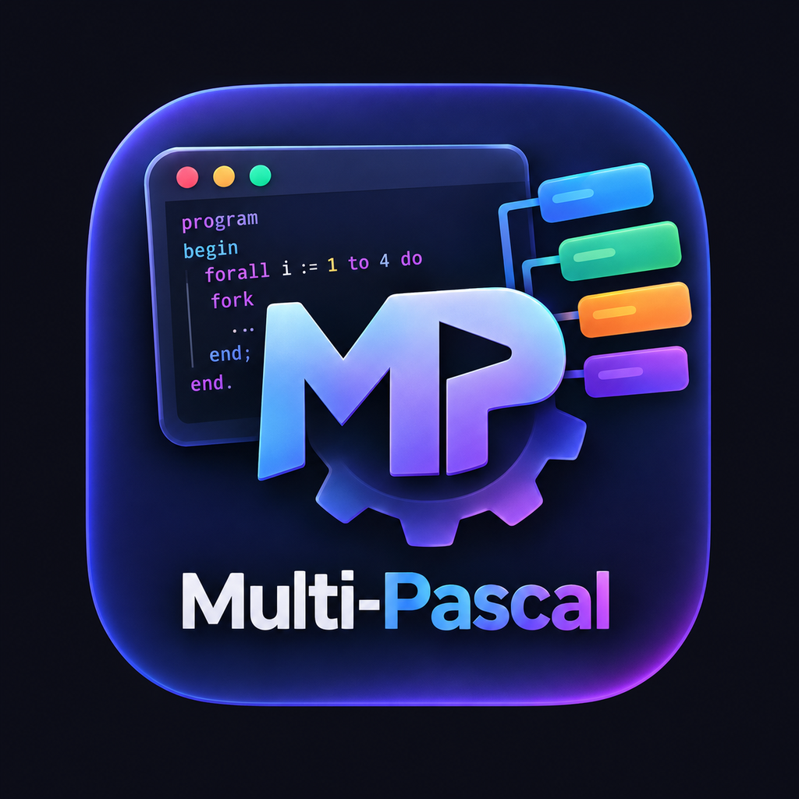

# Multi-Pascal Mac

**A native macOS workbench for the MPWin / Multi-Pascal teaching language.**

Multi-Pascal Mac brings a classic parallel-programming teaching language into a modern SwiftUI/AppKit application. It includes a source editor, a Pascal-family front end, an interpreter, and a deterministic processor/process simulator for exploring how MPWin programs execute.



**Maintainer:** Amirali Yazdani  
**Platform:** macOS 14 or later  
**Implementation:** Swift, SwiftUI, AppKit, Swift Package Manager

[Features](#features) · [Run the app](#run-the-macos-app) · [Command-line runner](#command-line-runner) · [Tests](#testing) · [Documentation](#documentation) · [Distribution](#build-a-dmg)

## Features

- Pascal/MPWin source editor with line numbers, syntax coloring, find, and ordinary editing shortcuts.
- Compile diagnostics with source locations and caret context.
- Step, continue, stop, reset, breakpoints, and process-state inspection.
- MPWin constructs including `FORALL`, `FORK`/`JOIN`, grouping, processor placement, ports, channels, and spinlocks.
- Integer, real, Boolean, and character values; arrays, records, pointers, named types, procedures, and functions within the supported dialect.
- `READ` / `READLN` input from an input panel or file.
- Architecture/topology visualization and configurable timing/scheduling parameters.
- Processor activity timelines, process trees, event inspection, and virtual-time statistics.
- A separate command-line runner for scripted examples and regression checks.

## Run the macOS app

Requirements:

- macOS 14 Sonoma or later.
- Xcode with a Swift 6-capable toolchain, or a compatible Swift toolchain installed separately.

1. Clone or download this repository.
2. Open `Package.swift` in Xcode.
3. Select the `MultiPascalMac` scheme and the **My Mac** run destination.
4. Build and run.

The app bundle/DMG scripts are intended to run on macOS. The package's compiler core and command-line runner can also be tested on Linux, but Linux cannot verify the AppKit/SwiftUI interface.

## Command-line runner

Build and run the interpreter from the repository root:

```sh
swift build -c release
swift run mpwin Samples/HelloParallel.mpf
swift run mpwin Samples/RankSortParallel.mpf --input Samples/RankSortParallel.in
```

Available options:

```text
--input <file|->       Read READ/READLN input from a file or standard input
--time-limit <n>       Stop when the simulated time reaches n
--policy <policy>      round-robin, random, or shortest-job-first
--seed <n>             Set the scheduler/variation seed
--free                 Disable simulated timing costs
-h, --help             Display command-line help
```

## Included samples

| File | Demonstrates |
|---|---|
| `Samples/HelloParallel.mpf` | A minimal `FORALL` program |
| `Samples/ParallelMatrixMultiplication.mpf` | Matrix work distributed among simulated processes |
| `Samples/RankSortParallel.mpf` | RankSort using `FORALL` and file-provided input |
| `Samples/Processors.mpf` | Explicit processor placement |
| `Samples/Channels.mpf` | Channel communication |
| `Samples/ReadExample.mpf` | `READ` / `READLN` input |

## Testing

Run the core test suite with:

```sh
swift test
```

Build the release products with:

```sh
swift build -c release
```

The tests cover parser grammar and precedence, declarations and types, built-in functions, arithmetic and overflow handling, loops, arrays/records/pointers, channels, process creation and synchronization, processor placement, input, simulated timing, and invalid or oversized source constructs.

GitHub Actions runs the tests and release build on a macOS runner and smoke-tests the bundled sample programs. The native UI should additionally be launched and exercised on macOS before a release.

## How the simulator models parallelism

The current machine is a **deterministic, single-threaded interpreter/simulator**. It schedules multiple simulated processes across virtual processors and derives parallel elapsed time from each processor's modeled workload. The app does not create one native operating-system thread per simulated processor.

Processor activity and speedup values represent simulated cost units. They are not measurements of host CPU utilization or real wall-clock parallel performance, and the timing model has not been fully calibrated against the original Windows MPWin executable.

## Language compatibility

Multi-Pascal Mac implements a documented subset of the MPWin / Multi-Pascal dialect. It is not a general-purpose compiler for every Pascal dialect, and compatibility with every historical MPWin program is not guaranteed. Unsupported constructs are documented and should be reported rather than assumed to work.

The recovered language notes and known limitations are documented in:

- [`docs/COMPATIBILITY.md`](docs/COMPATIBILITY.md) — supported areas, limits, and validation scope.
- [`docs/MPWinSpec.md`](docs/MPWinSpec.md) — recovered language and runtime notes, with source references.
- [`docs/COMPILER_CHOICES.md`](docs/COMPILER_CHOICES.md) — research into possible external compiler components.
- [`docs/DEVELOPMENT.md`](docs/DEVELOPMENT.md) — project structure and development commands.

For example, enumerated types, subrange types, sets, packed arrays, variant records, files, and string variables are outside the recovered MPWin subset. String literals and output are supported. Safety limits currently cap simulated storage at 1,000,000 words and process creation at 10,000 processes.

## Build a DMG

To create a local development app bundle and DMG on macOS:

```sh
chmod +x BuildMacApp.command PackageDMG.command
./PackageDMG.command
```

The output is written to `dist/Multi-Pascal-Mac-1.1-Amirali-Yazdani.dmg`. The default build is **unsigned** and intended for development/testing. For a public release, use a Developer ID Application identity and notarize both the app and DMG. See [`docs/DISTRIBUTION.md`](docs/DISTRIBUTION.md) for setup, commands, verification, and troubleshooting.

## Privacy

The app processes source code and input locally. It does not include analytics or telemetry in the current implementation. Source files are opened and saved only through user-initiated file panels. See [`PRIVACY.md`](PRIVACY.md).

## License and acknowledgements

Original code in this repository is released under the MIT License; see [`LICENSE`](LICENSE). The implementation is a clean-room reimplementation informed by the historical MPWin documentation and examples referenced in [`docs/MPWinSpec.md`](docs/MPWinSpec.md). The original MPWin application and its manuals are not included.

Copyright © 2026 Amirali Yazdani.
